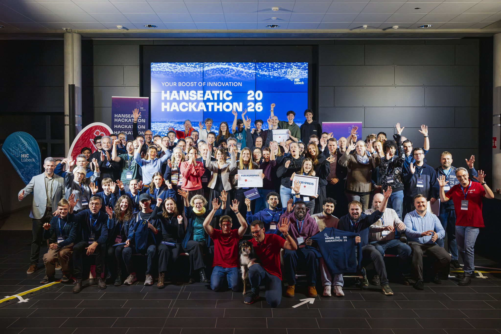
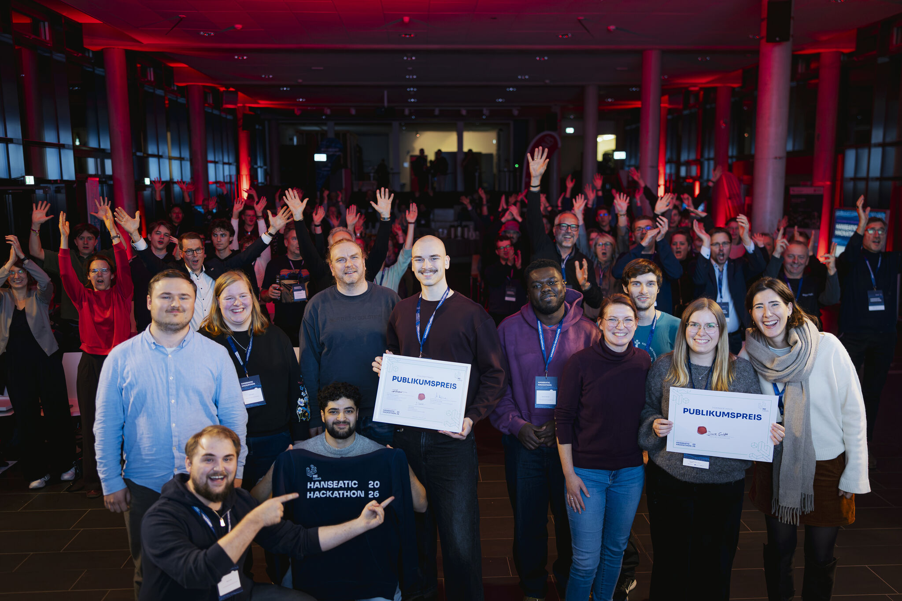

48 Stunden im Bauforum der TH Lübeck. Sechs Cases aus der Region. Team Hanse hat den Case der Stadtwerke Lübeck genommen.

Ideen kommen aus einer SharePoint-Liste, meist mit 4 von 24 Feldern. Der Ideen-Enricher: zwei Agenten, der Mensch entscheidet. Ein Vorschlag mit Quelle dauert etwa 13 Sekunden, der Steckbrief etwa eine Minute. Stack: FastAPI, LangChain, Next.js, Modelle auf myLab.

Die Folien sind auf Deutsch, für den KI-Stammtisch.

- **Folien:** [Hanseatic Hackathon — KI Stammtisch](https://mmuller88.github.io/presentations/ki-stammtisch-hanseatic-2026/?utm_source=martinmueller&utm_medium=blog)
- **Programm:** [Hanse Innovation Campus](https://hanse-innovation-campus.de/de/hanseatic-hackathon-2026-programm)

## Pitch, 48 Sekunden

<video controls playsinline preload="metadata" poster="/hanseatic-hackathon/ideen-enricher-pitch.jpg?v=1" aria-label="Ideen-Enricher-Pitch, 48 Sekunden" class="mb-4 aspect-video w-full rounded-xl">
  <source src="/hanseatic-hackathon/ideen-enricher-pitch.mp4?v=1" type="video/mp4" />
</video>

## Demo, 60 Sekunden

<video controls playsinline preload="metadata" poster="/hanseatic-hackathon/ideen-enricher-demo.jpg?v=1" aria-label="Ideen-Enricher-Demo, 60 Sekunden" class="mb-4 aspect-video w-full rounded-xl">
  <source src="/hanseatic-hackathon/ideen-enricher-demo.mp4?v=1" type="video/mp4" />
</video>

## Samstagabend

Alle Teams.

Publikumspreis.
