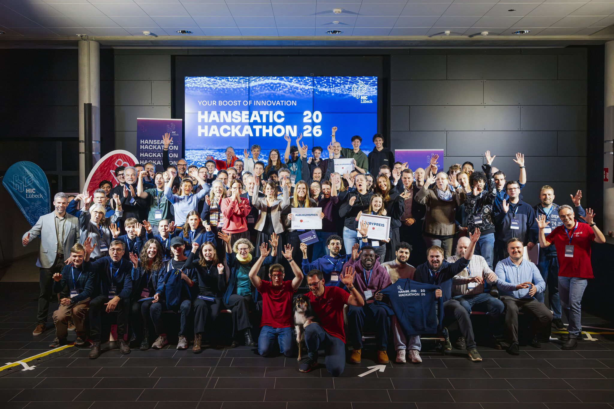
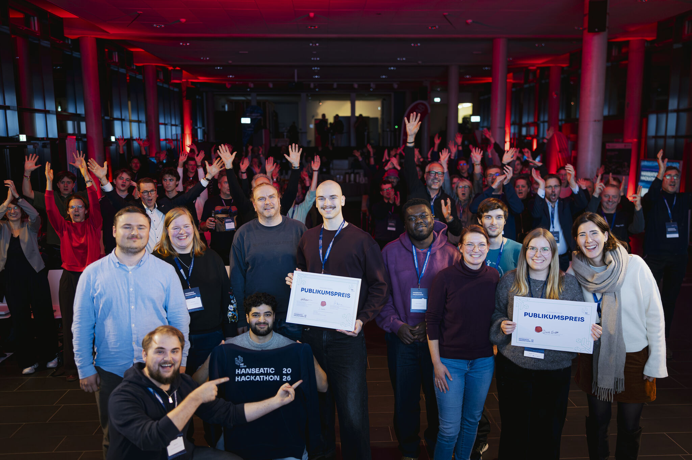

48 hours at the Bauforum, TH Lübeck. Six company cases from the region. Team Hanse took Stadtwerke Lübeck.

Ideas arrive from a SharePoint list with 4 of 24 fields filled. The Ideen-Enricher uses two agents, and a person decides. A sourced suggestion takes about 13 seconds. The brief takes about a minute. Stack: FastAPI, LangChain, Next.js, models on myLab.

The deck is in German. I will use it at the KI Stammtisch.

- **Slides:** [Hanseatic Hackathon — KI Stammtisch](https://mmuller88.github.io/presentations/ki-stammtisch-hanseatic-2026/?utm_source=martinmueller&utm_medium=blog)
- **Program:** [Hanse Innovation Campus](https://hanse-innovation-campus.de/de/hanseatic-hackathon-2026-programm)

## Pitch, 48 seconds

<video controls playsinline preload="metadata" poster="/hanseatic-hackathon/ideen-enricher-pitch.jpg?v=1" aria-label="Ideen-Enricher pitch, 48 seconds" class="mb-4 aspect-video w-full rounded-xl">
  <source src="/hanseatic-hackathon/ideen-enricher-pitch.mp4?v=1" type="video/mp4" />
</video>

## Demo, 60 seconds

<video controls playsinline preload="metadata" poster="/hanseatic-hackathon/ideen-enricher-demo.jpg?v=1" aria-label="Ideen-Enricher demo, 60 seconds" class="mb-4 aspect-video w-full rounded-xl">
  <source src="/hanseatic-hackathon/ideen-enricher-demo.mp4?v=1" type="video/mp4" />
</video>

## Saturday evening

All teams.

Audience prize.
